# Azure Retail Sales, Orders and Inventory Analytics Platform

Northline Outfitters is a multi-channel outdoor retailer (stores, web, marketplace). This repository is the lakehouse that turns twice-daily order, payment, return, and warehouse files into a star schema: net sales, average order value, return rate, sell-through, stock-out days, inventory turnover, days of supply, and customer RFM.

The transformation code is the library a Databricks job imports (`src/northline`). It runs locally and in GitHub Actions on PySpark and Delta Lake. Azure Data Factory, ADLS, Key Vault, Synapse, Unity Catalog, the Asset Bundle, and the Power BI model are deploy-ready artifacts. They were not executed against a live subscription or the Power BI service.

The dataset is synthetic. There is no real customer or payment data.

## Business problem

Merchandising and finance do not share a book. The order system cancels and partially returns lines after the warehouse has already moved inventory. Customer loyalty tier and product price or category change, and a late file can describe a sale whose customer or SKU is not on the master extract yet. Nightly on-hand snapshots sometimes disagree with the movement stream, including a count that would go negative if it were posted.

The platform has to:

- ingest each morning and evening batch once, and survive a rerun without duplicating orders
- apply a CDC feed (insert, update, delete) in sequence order with Delta MERGE, and ignore a stale replay
- keep customer and product history (SCD Type 2), including price and category
- keep a fact that arrived before its dimension, using an inferred member until the master record shows up
- quarantine bad rows instead of failing the whole day, and still fail the run when the inventory book does not match the expected breaks
- publish a star schema for net sales, AOV, return rate, channel and category performance, sell-through, days of supply, stock-out days, and RFM

## What actually ran

On this machine, Java 21, Python 3.12.3, PySpark 3.5.5, delta-spark 3.2.1, small sample, seed 42:

| Step | Result |
| --- | --- |
| `generate --scale small --seed 42` | Six batches under `data/sample` (2024-11-08 through 2024-11-10) |
| `run --env dev` | `SUCCESS`, run `20261029T172649Z-ca9832c8`, **217.403 s** |
| Rerun, same lake | `SUCCESS`, run `20261029T173107Z-50563b75`, **72.295 s**, **6 batches skipped** |
| Reconciliation | **15 checks, 0 failed** |
| Gold `fact_sales` | **198** lines, **155** non-cancelled orders, **1** cancelled order |
| Net sales / AOV / unit return rate | **$22,169.25** / **$143.03** / **2.37%** |
| Quarantine | **20** rows, **20** rules (one row each) |
| Exact in-file duplicates removed | **2** (`O-DUP-0001` order and line) |
| Planted inventory variance | `SKU-SHL-0001` / `STR01`: **−1** on 2024-11-09, **+1** on 2024-11-10 |

Screenshots below are from that run, from the local Streamlit app over those Gold tables, and from pytest. There are no pictures of the Azure portal, Databricks, ADF, Synapse, or Power BI.

Local `OPTIMIZE ... ZORDER BY (store_id, sku)` on that same run:

| Table | Files before → after | Bytes before → after | Seconds |
| --- | --- | --- | --- |
| fact_sales | 4 → 3 | 56,965 → 46,850 | 2.143 |
| fact_inventory_movement | 8 → 3 | 41,776 → 19,290 | 1.703 |
| fact_inventory_snapshot | 4 → 4 | 18,464 → 18,464 | 1.487 |

The snapshot table did not get smaller. Each date partition was already one small file. Details: [docs/performance.md](docs/performance.md).

## Tested here vs needs a subscription

| Feature | Where it was executed |
| --- | --- |
| Seeded generator (tiny, small) | Local. Medium is implemented and not committed |
| Bronze append, ingest-hash dedupe | Local and CI |
| DQ quarantine and `DQ_FAIL_RATE` alerts | Local and CI |
| Watermark skip and `--force` replay | Local integration test and the rerun above |
| CDC MERGE, stale sequence ignored | Local (`O-CAN-0001` stays `CANCELLED`, sequence 1363) |
| SCD2 customer tier, product price, product category | Local |
| Inferred late customer and late SKU, then mastered | Local (`C000999`, `SKU-NEW-0001`; `C000998` stays inferred) |
| Partial line return and order cancellation | Local (`O-RET-0001` refund $229.00, net $687.00) |
| Inventory rollforward, negative-on-hand quarantine, variance vs manifest | Local, 15/15 checks PASS |
| Gold marts, local Streamlit dashboard | Local |
| `OPTIMIZE` Z-order file counts above | Local only |
| ADF pipelines, triggers, Key Vault linked services | Authored, not executed |
| ADLS `abfss://` paths and Unity Catalog registration | Code switches on config; not executed |
| Databricks Asset Bundle deploy | YAML authored; not deployed |
| Synapse serverless `OPENROWSET` and dedicated CTAS | SQL authored; not executed |
| Bicep (storage, ADF, Databricks, Synapse, Key Vault) | Authored; CD skips without secrets |
| Power BI model and DAX | Written in [docs/powerbi.md](docs/powerbi.md); no `.pbix`, service not used |

## Architecture

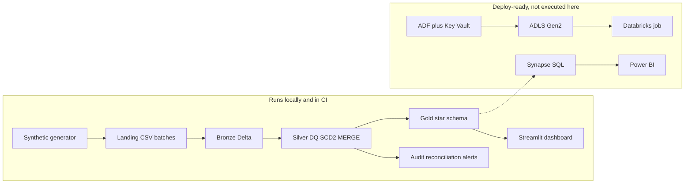

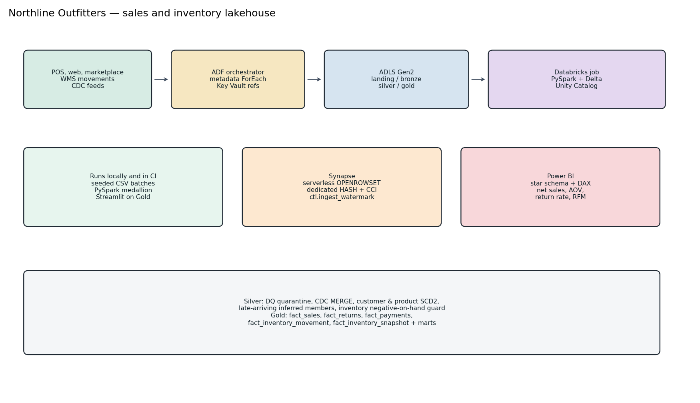

More detail: [docs/architecture.md](docs/architecture.md), [docs/data-flow.md](docs/data-flow.md).

## Tech stack

| Piece | How it is used |
| --- | --- |
| Python 3.12 | Generator, CLI, tests, dashboard |
| PySpark 3.5 + Delta Lake 3.2 | Local and CI medallion engine |
| SQL | Gold marts executed by Spark; Synapse serverless and dedicated scripts |
| Azure Data Factory | Metadata ForEach, watermark copy, Key Vault linked service, twice-daily trigger, Databricks activity |
| ADLS Gen2 | `abfss://` paths when `NL_STORAGE_MODE=adls` |
| Databricks | Job entry `src/northline/jobs/run_medallion.py`, Asset Bundle |
| Azure Synapse | Serverless `OPENROWSET` over Gold Delta; dedicated pool `HASH` + columnstore |
| Azure Key Vault | Linked service for the Synapse password; secret scope documented for Databricks |
| Power BI | Semantic model and DAX in [docs/powerbi.md](docs/powerbi.md) |
| GitHub Actions | CI runs lint, generator smoke, pytest, and the sample pipeline. CD skips when Azure secrets are absent |
| Bicep | Storage, Key Vault, Data Factory, Databricks workspace, Synapse workspace and SQL pool |

## Data model

Landing entities: customers, products, stores, channels, promotions, orders, order lines, payments, returns, inventory movements, inventory snapshots, and CDC files for customers, products, orders, lines, and payments.

Silver current grain for orders is `order_id`. Lines are `order_id + line_number`. Customers and products are SCD Type 2. The first snapshot opens on `2020-01-01` so an order that predates the file still resolves. Inferred members use the same epoch and `applied_sequence = -1`.

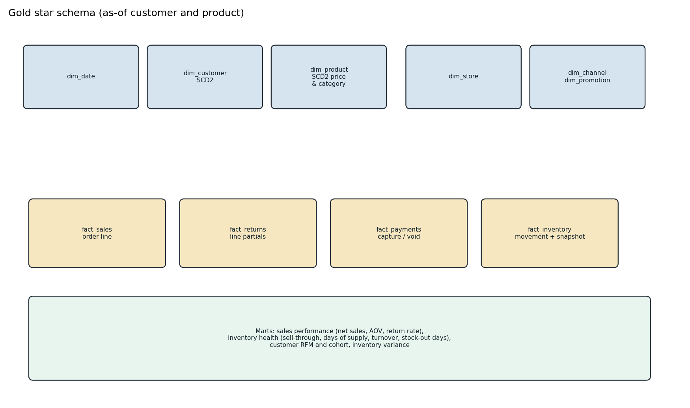

Full write-up: [docs/data-model.md](docs/data-model.md). Column meanings: [docs/data-dictionary.md](docs/data-dictionary.md).

## Layer-by-layer flow

1. **Generate.** Faker and NumPy, seed 42. Scales `tiny` (tests), `small` (committed sample), `medium` (4,000 customers, 14 days, not committed).
2. **Ingest.** Spark CSV with an explicit string schema and `_corrupt_record`. Bronze `ingest_id` is a hash of batch, entity, and payload.
3. **Bronze.** Raw strings plus ingest metadata. An identical payload in the same batch collapses to one row.
4. **Silver.** Typed rules, referential checks, SCD2, sequence MERGE, snapshot upsert, movement guard, inferred members.
5. **Gold.** Full rebuild: facts, dimensions, then SQL marts in `sql/gold/`.
6. **Audit.** Run row, DQ metrics, reconciliation, alerts. JSONL logs under `data/logs`.

Batch contents:

| Batch | Purpose |
| --- | --- |
| 2024-11-08T0600 | Dimension snapshots and opening inventory (2024-11-07), including a zero row for the not-yet-mastered mug |
| 2024-11-08T1800 | Friday sales, receipt, transfer, cycle count, in-file duplicate |
| 2024-11-09T0600 | Friday close snapshot. Loyalty CDC (`C000001` SILVER → GOLD). Tent price 229 → 249 and Cedar Flannel Apparel → Outlet |
| 2024-11-09T1800 | Saturday sales, one-unit return of a four-unit tent line, shrink, cancel-later order still `OPEN` |
| 2024-11-10T0600 | Saturday close with a planted −1 snapshot. Cancel CDC, voided tender, bad rows, corrupt line, late facts |
| 2024-11-10T1800 | Sunday sales, truthful close (the −1 reverses to +1), mastered late customer and SKU, deletes, stale cancel replay |

## Engineering features

**Incremental.** `audit.batch_commit` records a batch only after silver commits. The rerun above skipped all 6. `--force` replays the files; bronze dedupe and MERGE keep the grain. The integration test deletes nothing and still replays.

**CDC MERGE.** A higher `sequence_number` replaces the current order. A lower sequence does not. After the Sunday stale replay, `O-CAN-0001` is still `CANCELLED` at sequence **1363**. The payment is `VOIDED` for **$36.21**. Net sales on that line are **$0.00**.

**SCD2.** `C000001` (Jordan Hale) is SILVER from 2020-01-01 through 2024-11-09T06:00:00Z, then GOLD. Friday's tent order (`O-RET-0001`) joins SILVER and list price 229.00. Saturday's tent order (`O-PRICE-0001`) joins GOLD and list price 249.00, with a Trail Week discount of 37.35. Cedar Flannel is Apparel on Friday (`O-CAT-0001`) and Outlet on Sunday (`O-CAT-0002`).

**Late facts.** `O-LATE-0001` is a Friday-night web order ingested Sunday morning, before customer `C000999` and SKU `SKU-NEW-0001` are mastered. The fact stays on the inferred versions (`is_inferred_customer` and `is_inferred_product` true). Sunday evening CDC closes those rows and opens Rowan Ellis / Trail Mug. `C000998` never arrives, so the inferred member stays current and the fact still conforms. Category `UNKNOWN` on that one mug line is **$16.00** of the category total.

**Partial returns and cancels.** `O-RET-0001` ordered 4 units ($916.00 gross) and returned 1. Merchandise refund **$229.00**, net **$687.00**. A return of 99 units and a zero-qty return are quarantined, not posted.

**Inventory.** Opening balance is the first snapshot and is not variance-checked. Later days must match the previous snapshot plus signed movements. The negative shrink of the stocked-out lantern (`M-NEG-0001`, `SKU-LGT-0003` at `STR02`) is quarantined and is not in silver. Stock-out days for that sku/store are **4**. The only non-zero variances are the planted −1 and the reversing +1. Reconciliation fails if that set changes.

**Data quality.** The Sunday 06:00 extract raises `DQ_FAIL_RATE` (threshold 0.15) and does not fail the job. Quarantine rules on this run include `BAD_EMAIL`, `BAD_QTY`, `BAD_AMOUNT`, `ORPHAN_PAYMENT`, `RETURN_EXCEEDS_SALE`, `NEGATIVE_ON_HAND`, `BAD_MOVEMENT_TYPE`, and `CORRUPT_ROW`. `C000003` keeps `samir.cole@northline.example`; the bad-email CDC did not apply. `C000010` is a current delete tombstone with the prior ACTIVE row closed.

**Reconciliation.** 15 PASS: grains, one current SCD row, no overlapping versions, cancelled net sales equal 0, fact grain matches silver lines with no null surrogate, every shipped line has a sale movement, no negative running on-hand, and variances match `manifest.json`.

**Recovery.** `run --fail-after silver` commits batches, marks the run failed, and skips gold. The next run rebuilds gold and does not duplicate orders. Covered by `tests/test_integration.py`.

**Monitoring.** `audit.pipeline_run`, `audit.dq_metric`, `audit.reconciliation`, `audit.alert`. Logs are JSONL. Optional `NL_ALERT_WEBHOOK_URL`. A webhook failure does not fail the pipeline.

## Sample analytics

Small book, seed 42, 100 customers on the opening snapshot, service dates 2024-11-08 (Friday) through 2024-11-10 (Sunday). Trail Week (15% off Shelter) runs Saturday and Sunday. These are synthetic figures, not a commercial benchmark.

| Date | Net sales |
| --- | --- |
| 2024-11-08 | $6,326.00 |
| 2024-11-09 | $8,453.65 |
| 2024-11-10 | $7,389.60 |

| Channel | Net sales |
| --- | --- |
| RETAIL | $14,339.35 |
| WEB | $5,919.80 |
| MARKETPLACE | $1,910.10 |

| Category | Net sales |
| --- | --- |
| Shelter | $7,817.25 |
| Apparel | $4,726.00 |
| Cook | $4,620.00 |
| Light | $4,242.00 |
| Outlet | $748.00 |
| UNKNOWN (inferred mug) | $16.00 |

Gross sales **$23,081.35**. COGS on lines with a known as-of cost **$9,541.12**. 84 customers have a non-cancelled purchase; RFM monetary sums to the same **$22,169.25**. Highest monetary in this book: `C000001` at **$1,322.70** (6 orders). Cohort is a single November 2024 month because the sample window is three days. Median days of supply on the health mart is **39** at a 3-day window; that is a short-window statistic, not an annual plan.

## Repository layout

```text
src/northline/       generator, ingest, silver, gold, audit, pipeline, CLI
conf/                dev, test, prod settings and the source catalog
data/sample/         committed small dataset and manifest
sql/gold/            marts executed locally
sql/checks/          reconciliation SQL executed locally
sql/synapse/         serverless OPENROWSET and dedicated CTAS
adf/                 linked services, datasets, pipelines, trigger, control file
synapse/             dedicated refresh pipeline JSON
infra/               Bicep and parameter files
dashboard/           local Streamlit app
tests/               unit tests and the tiny end-to-end run
docs/                architecture, model, deployment, runbook, Power BI, ADRs
.github/workflows/   CI and guarded CD
```

## Local quickstart

Requires Python 3.11+ and a JDK (17 or 21).

```bash
make setup
make pipeline
make test
make dashboard
```

`make generate` rewrites `data/sample`. The copy in git is that dataset, so a reviewer can skip generation.

```bash
NL_LANDING=data/sample NL_LOCAL_ROOT=data/lake NL_LOG_DIR=data/logs \
  .venv/bin/python -m northline.cli run --env dev
```

Set `NL_STORAGE_MODE=adls` and `NL_CATALOG_MODE=unity` only on a Databricks cluster that can see the lake. Dev defaults stay on the local filesystem.

Dashboard: http://localhost:8501 after `make dashboard`. The caption states that Power BI is the production target.

Setup notes: [docs/setup.md](docs/setup.md). Operations: [docs/runbook.md](docs/runbook.md). If something fails: [docs/troubleshooting.md](docs/troubleshooting.md).

## Azure deployment

Step-by-step: [docs/deployment.md](docs/deployment.md).

Short version: deploy `infra/main.bicep` (password from a secret, not from the parameter file), create Key Vault secrets and a Databricks secret scope, import `adf/` JSON, run the Synapse SQL, `databricks bundle deploy -t dev`, and connect Power BI using the DAX in [docs/powerbi.md](docs/powerbi.md).

Decisions are in [docs/adr/](docs/adr/).

## Testing

```bash
make test
```

On this workspace that command's pytest invocation reported **14 passed** and **89%** coverage on `northline` (statement coverage, `cli.py` and `jobs/` omitted). The XML report is produced in CI; it is not committed.

Unit tests cover movement signs, the pure-Python rollforward, local vs `abfss` paths, retry-on-conflict vs no-retry, SCD2 (including a same-hash no-op, a second change, a stale replay, and inferred-member resolution), order MERGE, and the ADF control file matching `conf/sources.yml`.

`tests/test_integration.py` generates a tiny dataset and:

1. runs the full medallion path and checks the planted cancel, partial return, SCD as-of attributes, late members, quarantine rules, broadcast join, and 15/15 reconciliation
2. reruns, skips the six committed batches, and keeps the fact grain
3. replays with `--force` and keeps the cancelled status
4. in a second test, fails after silver, then recovers gold on the next run

## CI/CD

`.github/workflows/ci.yml` installs Java 21 and Python 3.12, runs Ruff, validates ADF JSON and the bundle YAML, smoke-generates a tiny dataset, runs pytest with coverage, and runs the committed sample pipeline.

`.github/workflows/cd.yml` targets GitHub environments `dev` and `prod`. If Azure, Databricks, or Synapse secrets are empty, the job logs a skip and succeeds. Prod runs only from `workflow_dispatch`.

## Screenshots from the local run

Pipeline stdout (small scale, 217.403 s):

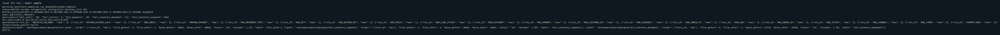

Rerun with batches skipped (72.295 s):

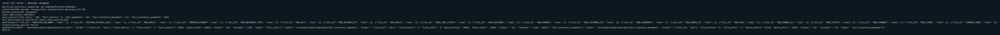

Reconciliation is 15 PASS / 0 FAIL on that run (printed in the stdout above). Planted variance:

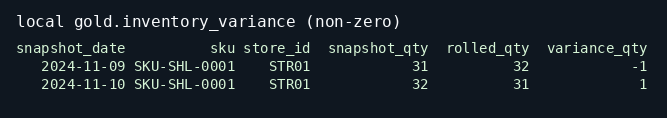

Quarantine rules:

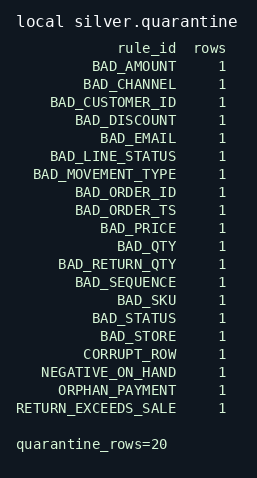

SCD2 customer history (tier change and late members):

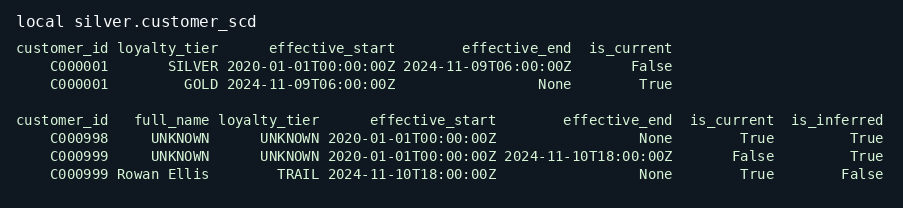

CDC result for the cancelled order after the stale replay:

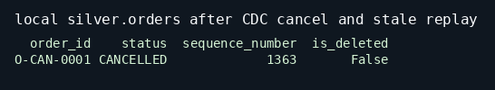

Pytest (14 passed, 89% coverage on `northline`):

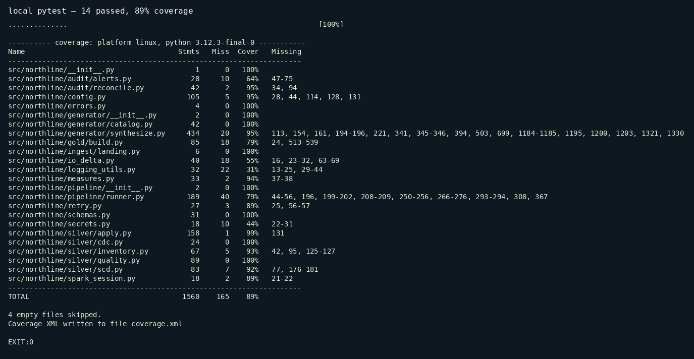

Local Streamlit dashboard over the same Gold tables. The caption on the page says Power BI is the production target.

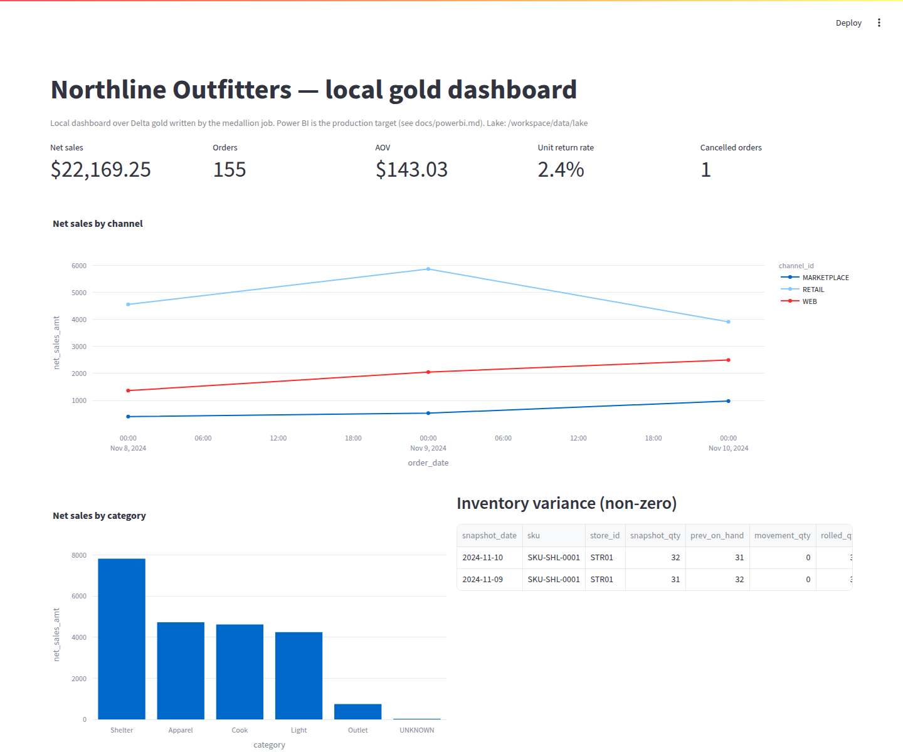

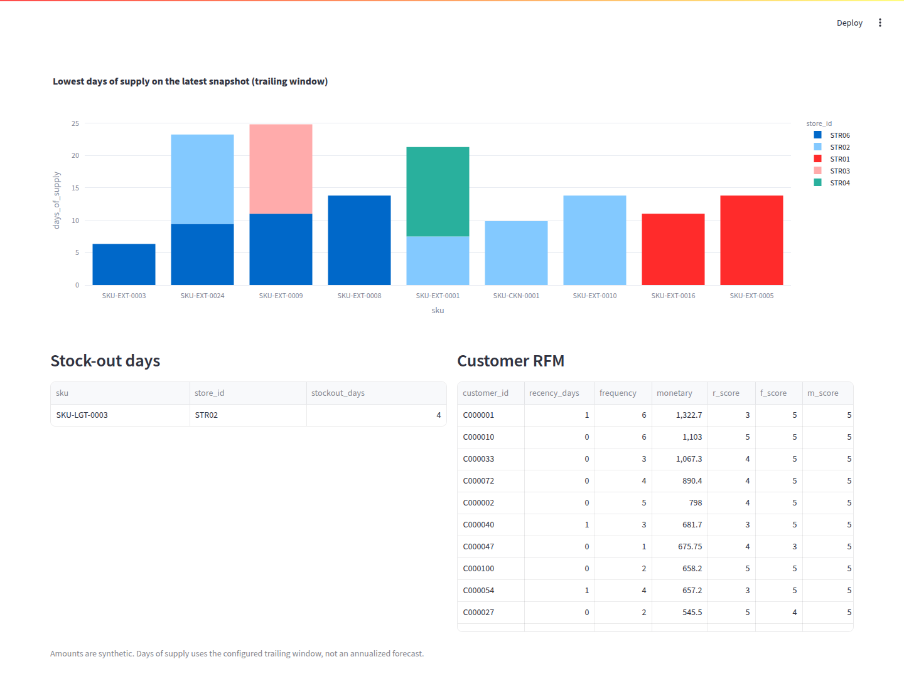

Raw transcripts: [docs/run_output/pipeline.txt](docs/run_output/pipeline.txt), [docs/run_output/pipeline_rerun.txt](docs/run_output/pipeline_rerun.txt).

## Challenges

- A full gold overwrite cannot combine `overwriteSchema` with Spark's dynamic partition overwrite. The writer sets static partition overwrite for those saves. The first end-to-end attempt failed on that Delta error; the rerun after the fix skipped the six already-committed batches and built gold.
- A one-night snapshot glitch does not stay a single variance if the next snapshot is truthful. The generator records both the −1 and the reversing +1, and the pipeline has to match that set.
- Facts that land before dimensions need an epoch-dated inferred member. Starting the inferred row at ingest time would miss an order whose event time is earlier than the file.
- Posting a shrink onto a zero on-hand lantern is a different problem from a snapshot that is merely short. The first is quarantined. The second is a variance.

## Future work

- Incremental gold by order date, once daily volume justifies it
- Liquid clustering on a Databricks runtime (local OSS Delta uses Z-order)
- Execute the Bicep stack, ADF trigger, and Synapse refresh in a real subscription
- FIFO or moving-average inventory cost; this model uses standard cost at the snapshot
- Refund tax inside net sales (refunds here are merchandise-only; tax sits on the tender)
