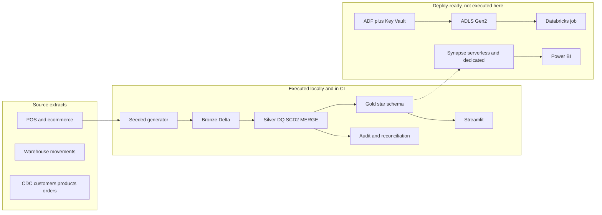
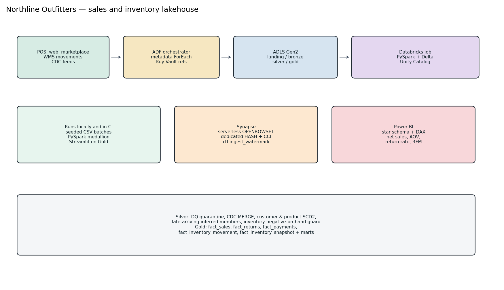

# Architecture

Northline Outfitters sells through stores, northline.com, and a marketplace. Orders, payments, returns, and warehouse movements land as twice-daily files plus a CDC feed. The lakehouse keeps one current order, customer and product history, and an inventory book that can be tied back to the nightly snapshot.

The Python package under `src/northline` is what a Databricks job imports and what `pytest` runs. `conf/*.yml` switches `storage.mode` between local directories and `abfss://{layer}@{account}.dfs.core.windows.net/{table}`, and `catalog.mode` between path-only tables and Unity Catalog three-part names.

## What is intentional

- **ADF is metadata-driven.** `PL_NL_Orchestrator` lookups `adf/control/ingest_sources.json` and ForEach-copies each source. The copy pipeline reads `ctl.ingest_watermark` in the dedicated pool and advances it after a successful copy.
- **Databricks is the system of record for row-level state.** `audit.batch_commit` skips a batch that silver already committed. CDC `sequence_number` on the silver row ignores a stale replay even if the file is copied again.
- **Gold is rebuilt** from current silver. Facts are small enough that as-of SCD joins and the inventory rollforward stay easier to reconcile as a full refresh. See `docs/adr/0001-gold-refresh.md`.
- **Synapse serves gold.** Serverless SQL uses `OPENROWSET` over Delta. The dedicated pool CTAS/INSERT uses hash distribution and columnstore as documented in `sql/synapse/dedicated/02_ctas_gold.sql`.

## Local versus Azure

| Path | Where it ran |
| --- | --- |
| Generator, bronze, silver, gold, quarantine, reconciliation, Streamlit | This workspace and GitHub Actions, on PySpark and Delta |
| ADF, ADLS, Databricks job cluster, Key Vault, Synapse, Power BI | Authored only. No subscription was available |
