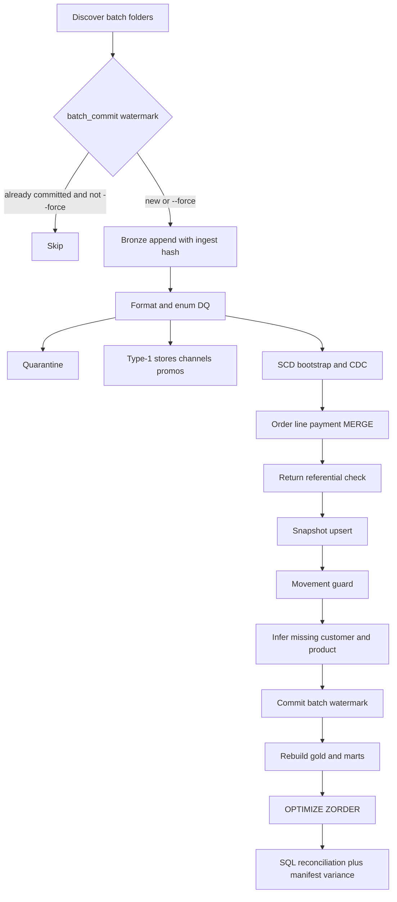

# Data flow

Each landing drop is a folder `batch_ts=YYYY-MM-DDTHHMM`. A calendar day has a 06:00 extract and an 18:00 extract. The sample committed in git is three days (2024-11-08 through 2024-11-10), six batches, seed 42.

## Batch contents in the sample

| Batch | What it carries |
| --- | --- |
| 2024-11-08T0600 | Customer, product, store, channel, and promo snapshots. Opening inventory dated 2024-11-07, including a zero balance for `SKU-NEW-0001` at the DC so the product dimension is inferred before the item master arrives. |
| 2024-11-08T1800 | Friday sales, a receipt, a DC-to-store transfer, a cycle count, and an in-file duplicate of `O-DUP-0001`. |
| 2024-11-09T0600 | End-of-day snapshot for 2024-11-08. Customer loyalty CDC. Product list-price and category CDC. |
| 2024-11-09T1800 | Saturday sales including the cancelled-later order (still `OPEN`, not picked), the post-price tent order, a one-unit return against Friday's four-unit tent line, and a shrink. |
| 2024-11-10T0600 | Snapshot for 2024-11-09 with a planted minus-one on `SKU-SHL-0001` / `STR01`. Cancel CDC, payment void, bad rows, a corrupt line, a late Friday order for `C000999` and `SKU-NEW-0001`, a ghost customer `C000998`, a shrink that would drive the stocked-out lantern negative, and a bad email CDC that must not apply. |
| 2024-11-10T1800 | Sunday sales, the closing snapshot, the real customer and product inserts, a customer delete, a product discontinue, a product hard delete, and a stale replay of the cancelled order at its original sequence. |

## Measures

- **Gross sales** on a non-cancelled line are `qty * unit_price - discount_amt`. Cancelled lines contribute zero. Tax is excluded.
- **Net sales** are gross minus merchandise refunds. `O-RET-0001` is 4 × 229.00 with a 229.00 refund, so net is 687.00.
- **AOV** is net sales divided by distinct orders that still have a non-cancelled line.
- **Unit return rate** is returned units divided by units on non-cancelled lines.
- **Inventory variance** for a snapshot after the opening balance is `snapshot_qty - (previous_snapshot_qty + signed movements since the previous snapshot)`.
- **Sell-through** is units sold in the trailing window divided by those units plus ending on-hand.
- **Days of supply** is ending on-hand divided by average daily units in that window. The window is 3 days in `conf/dev.yml` and `conf/test.yml`, and 28 in `conf/prod.yml`.
- **Turnover** in the mart is window COGS (sale qty × movement cost) divided by average on-hand cost. It is not annualized.
- **RFM** scores use `NTILE(5)` on the customers who purchased. Five is the best bucket.

## Late arrivals

An order or snapshot can name a customer or SKU that has no current dimension row. Silver inserts an inferred SCD row effective from `2020-01-01T00:00:00Z` with `applied_sequence = -1`. When the real CDC insert arrives, that row is closed at `change_ts` and the real version opens. A fact whose event time is before `change_ts` still joins the inferred version. That is why `O-LATE-0001` (order timestamp Friday night, mastered Sunday evening) keeps `is_inferred_customer` and `is_inferred_product` even after the current dimension is real.
