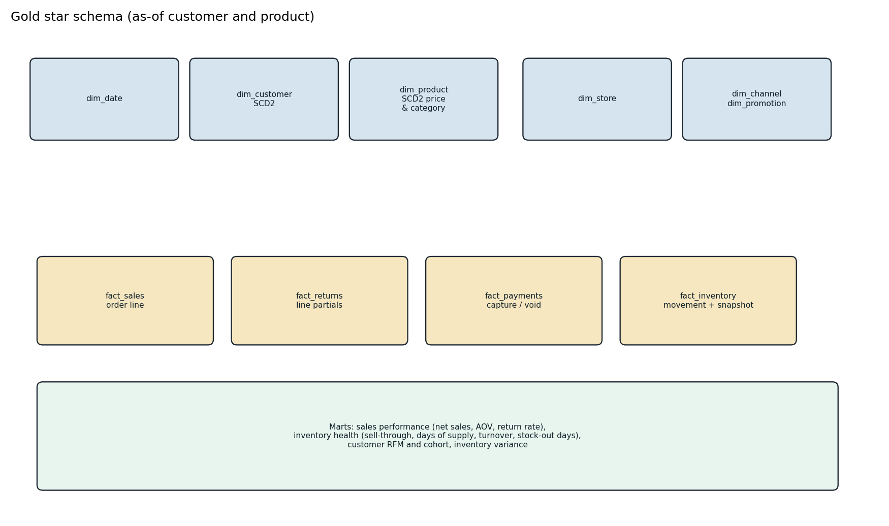

# Data model



## Landing

| File | Grain | Notes |
| --- | --- | --- |
| customers.csv | customer_id | Full snapshot. Not a CDC file. |
| products.csv | sku | Full snapshot. `SKU-NEW-0001` is absent until the CDC insert. |
| stores.csv, channels.csv, promotions.csv | natural key | Type-1 reference. |
| orders.csv, order_lines.csv | order, order+line | Insert image with `sequence_number`. |
| payments.csv | payment_id | `CAPTURED`, `VOIDED`, or `REFUNDED`. |
| returns.csv | return_id | Line-level. Partial qty is allowed. |
| inventory_movements.csv | movement_id | Receipt, sale, transfer in/out, adjustment, shrink, return. |
| inventory_snapshots.csv | date + sku + store | End-of-day on-hand. |
| cdc_*.csv | sequence_number | `op` is `I`, `U`, or `D`. Full after-image. |

Identifiers used by tests and the sample:

| Id | Story |
| --- | --- |
| `O-CAN-0001` | Open Saturday, cancelled Sunday morning before pick. Net sales 0. Stale replay ignored. |
| `O-RET-0001` | Friday, qty 4 of `SKU-SHL-0001`, one unit returned Saturday. Refund 229.00. As-of tier SILVER, list 229.00. |
| `O-PRICE-0001` | Saturday, after the list price moved to 249.00. Trail Week 15% discount. As-of tier GOLD. |
| `O-TIER-0001` | Saturday order for the same customer, tier GOLD. |
| `O-CAT-0001` / `O-CAT-0002` | Cedar Flannel before and after the Apparel → Outlet reclass. |
| `O-LATE-0001` | Fact before customer `C000999` and product `SKU-NEW-0001` are mastered. |
| `O-GHOST-0001` | Customer `C000998` never arrives. Dimension stays inferred. |
| `C000010` | CDC delete. Current row `is_deleted`, history kept. |
| `SKU-APP-0003` | Status DISCONTINUED. |
| `SKU-ERR-0001` | CDC hard delete. |
| `SKU-LGT-0003` at `STR02` | On-hand stays 0. Stock-out days. A shrink against it is quarantined. |
| `SKU-SHL-0001` at `STR01` | Snapshot 2024-11-09 is short one unit and 2024-11-10 reverses it. |

## Silver

- `customer_scd`, `product_scd`: `effective_start`, `effective_end` (null if current), `is_current`, `is_inferred`, `is_deleted`, `applied_sequence`, `record_hash`. Tracked customer attributes include loyalty tier, segment, home store, and address. Tracked product attributes include category, subcategory, list price, unit cost, and status.
- `orders`, `order_lines`, `payments`, `returns`: current image. MERGE requires a strictly greater `sequence_number`.
- `inventory_snapshot`, `inventory_movement`: movements store `qty_signed`. The guard refuses a post that would make on-hand negative.
- `quarantine`: one row per rule. `quarantine_id` is stable so a replay does not double-count.

## Gold

Facts are at order-line, return, payment, movement, and snapshot grain. `fact_sales` is partitioned by `order_date` and Z-ordered by `store_id, sku` when `OPTIMIZE` succeeds. Degenerate keys (`order_id`, `customer_id`, `sku`, `channel_id`) sit on the fact so a SQL check does not need every dimension. Surrogate keys are `xxhash64` of the natural key plus `effective_start` for SCD dimensions, so the Friday and Saturday versions of the same customer are different keys.

`dim_customer_current` and `dim_product_current` are the `is_current` slice for reports that want today's attributes rather than the as-of version on the fact.

Marts:

| Table | Grain |
| --- | --- |
| mart_sales_performance | date, channel, store, category |
| mart_inventory_health | snapshot date, sku, store |
| mart_stockout | sku, store |
| mart_customer_rfm | customer |
| mart_cohort | cohort month, activity month |
| inventory_variance | snapshot date, sku, store, after the opening balance |

## As-of predicate

```text
event_ts >= effective_start
AND (effective_end IS NULL OR event_ts < effective_end)
```

A change at `2024-11-09T06:00:00Z` applies to events at that timestamp and later. The previous version ends at that timestamp and does not include it.
